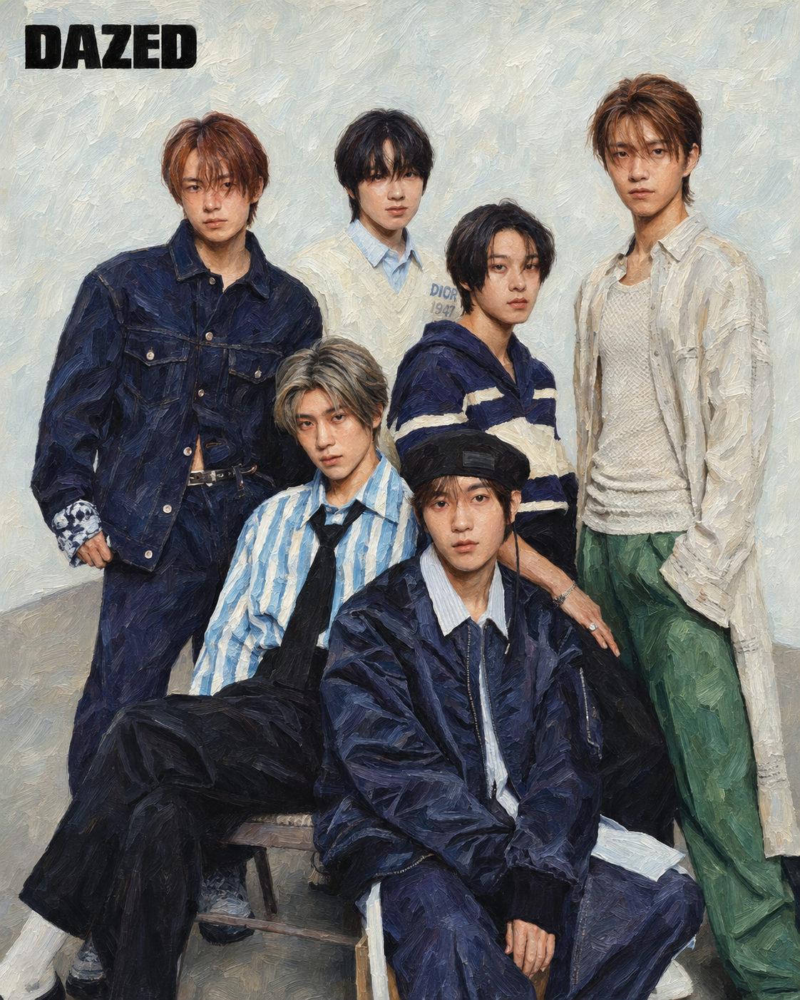

# painterly-oil-style

원본의 인물과 구도를 살리면서 유화 질감을 부위별로 조절하는 Codex 스킬입니다. 얼굴은 부드러운 색층으로 가볍게 회화 처리하고, 머리카락에는 중간 정도의 붓질을, 옷과 배경에는 더 풍부한 페인팅 질감을 줍니다.

## 예시

얼굴에는 은은한 회화적 색층, 머리카락에는 결을 따라 흐르는 붓질, 옷과 배경에는 더 풍부한 유화 질감을 적용한 예시입니다.



## 설치

저장소를 내려받은 뒤, PowerShell에서 저장소 폴더 안에서 실행하세요.

```powershell
$skillDir = if ($env:CODEX_HOME) {
  Join-Path $env:CODEX_HOME 'skills\painterly-oil-style'
} else {
  Join-Path $HOME '.codex\skills\painterly-oil-style'
}

New-Item -ItemType Directory -Force -Path $skillDir | Out-Null
Copy-Item .\SKILL.md (Join-Path $skillDir 'SKILL.md') -Force
```

## 사용

이미지를 첨부하고 Codex에서 다음처럼 요청하세요.

```text
$painterly-oil-style 이 사진을 부드럽고 풍부한 유화풍으로 바꿔줘.
```

기본 질감 강도는 얼굴은 약하게, 머리카락은 중간 정도, 옷과 배경은 더 강하게 적용합니다. 얼굴을 완전히 사진처럼 남기지 않고 부드러운 색층을 더하며, 선처럼 긁힌 붓자국은 피합니다.

원하면 강도를 더 구체적으로 지정할 수 있습니다.

- “얼굴은 부드럽고 알아볼 수 있게, 머리카락 붓질은 조금 더 보이게 해줘.”
- “옷과 배경의 색층과 붓질을 더 풍부하게 해줘.”
- “질감은 유지하고 선처럼 보이는 자국만 줄여줘.”

이미지 도구에 따라 얼굴 특징이 조금 달라질 수 있습니다. 결과에서 얼굴과 표정을 확인하고, 차이가 보이면 얼굴 보존을 우선한 수정 요청을 덧붙이세요.

